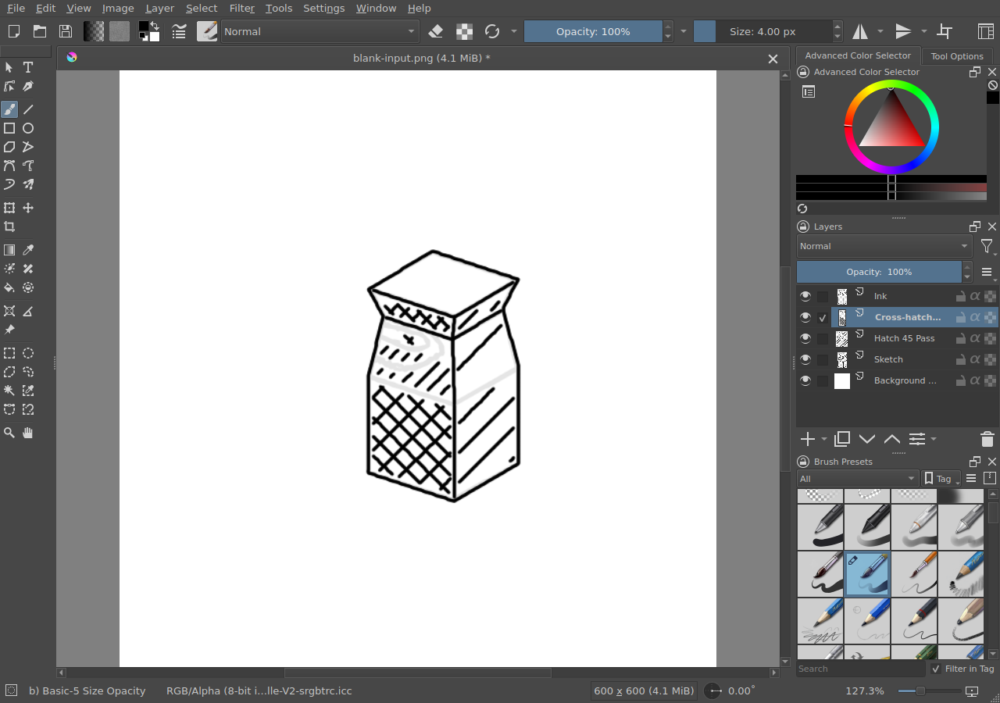

# CausalArt — measurable visual automation in Krita and Blender

**Domains:** Python automation, desktop UI control, constructive geometry, image observation, feedback, native document validation.

*Actual Krita framebuffer capture, Lesson 014 (November 7, 2026), showing a source-derived sketch and corrected graded-value ink on editable layers. Reproduced here from the project's private experimental archive; not a synthetic mockup or evidence of free-form autonomous artistry.*

## 1. What problem did I address?

A script issuing brush strokes or modeling commands can report success without checking what the application actually produced. I investigated a more accountable loop: represent intended geometry and operations, execute through the real application, observe rendered outputs and document state, compare expected and observed properties, and make a bounded correction.

## 2. What did I implement?

CausalArt is a **non-neural, experimental subsystem** of the private CausalGPT project. It includes:

- Source-labeled rational geometry and projected perspective/anatomical construction.
- Real mouse/pen interaction with Krita (including a separately tested pressure-sensitive Linux virtual-pen path), editable native `.kra` saves and layered visual inspection.
- Bounded Blender 4.0.2 operations, saved `.blend` and exported `.glb` files, reopened for independent topology checks.
- Screenshot-driven missing-stroke/value observations, corrective actions scoped to an affected property or layer, and receipts identifying what changed.
- A sequence of **14 documented lessons** by November 7, 2026, with both successful interventions and failure records.

It does **not** replace application behavior with direct hidden pixel compositing and it is not a pretrained drawing model.

## 3. What did I actually verify?

Recorded experiments in the **private** CausalGPT archive include:

| Exercise | Observed outcome | Limit |
| --- | --- | --- |
| Blender tutorial transfer (Lesson 010) | One intentionally incorrect face width was corrected; the procedure transferred to a second tower. Fresh Blender processes reopened two files with **16 vertices, 28 edges, 14 faces, and zero unpaired edges** each. | An authored, constrained modeling exercise; not autonomous reading of arbitrary tutorials |
| Visual-only Krita inking (Lesson 011) | A deliberately missing line region changed from **0** to **72** recorded ink pixels after focused correction; three editable paint-layer payloads were inspected. | Simple schematic shapes, not general visual perception |
| Graded value (Lesson 014) | Measured effective brush width **4.80 px** from a nominal 4-px setting. A withheld cross-hatch pass was corrected from **0.36** to **0.596** coverage against a 0.60 target; calibration transferred to a different object. | Bounded object studies with some planes too narrow for reliable judging |

The screenshot above is an actual execution artifact. These outcomes are documented in archived run records; the private source, full run receipts and native art files have **not** been made publicly runnable by this portfolio page.

## 4. What remains unresolved?

General-purpose autonomous art planning, artistic quality judged independently of the designed metrics, tilt-sensitive brush integration, broad application compatibility, and robust adaptation to unfamiliar visual targets. Geometry checks for watertightness or continuity do not alone establish anatomical plausibility or artistic competence.

**Access and attribution:** CausalArt code and its full lesson archive currently live in a private repository. The public image here is a bounded sample from one generated graphical exercise, not a public release of source code, personal files, or third-party assets. This study deliberately avoids claiming independently validated artistic intelligence.

[All featured projects](README.md) · [Portfolio home](../README.md)
